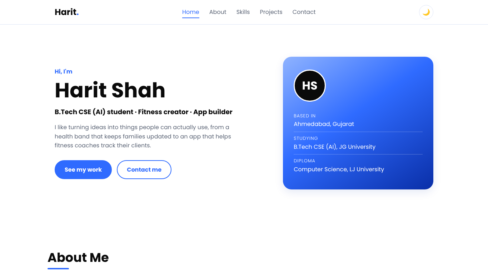
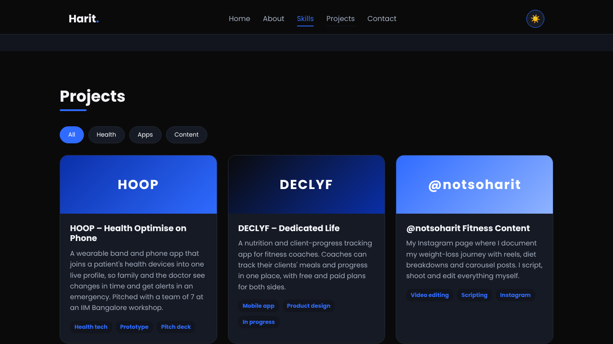
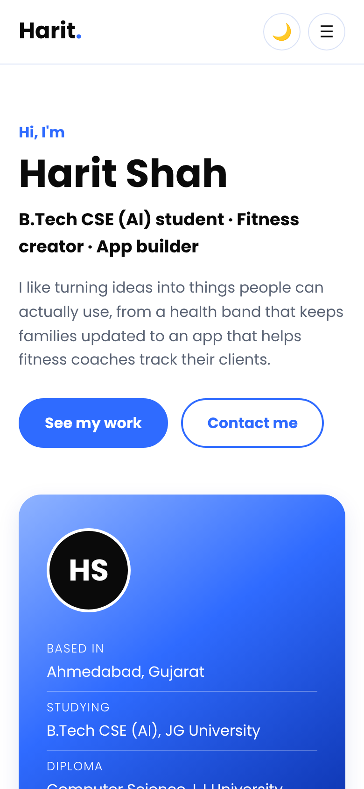

# Harit Shah – Personal Portfolio

My personal portfolio website, made for the **Web Technology** portfolio project (B.Tech CSE-AI).
It introduces me, lists my skills, shows my projects (HOOP, DECLYF and my @notsoharit fitness content) and has a contact form.

🔗 **Live site:** https://harit23.github.io/Harit_Shah_268225_Portfolio/



## Sections

- **Home** – name, short intro and quick facts
- **About Me** – my background in robotics, my diploma and my fitness page
- **Skills** – web, programming & AI, tools and creative skills
- **Projects** – HOOP, DECLYF and @notsoharit, with filter buttons
- **Contact** – a contact form that is checked before it is sent

## Technologies used

| Technology | Used for |
|---|---|
| HTML5 | Page structure with `header`, `nav`, `main`, `section`, `article` and `footer` tags |
| CSS3 (`style.css`) | Element, class and id selectors, hover effects, CSS variables, Flexbox, Grid and two media queries (900px and 640px) |
| JavaScript (`script.js`) | Dark mode, mobile menu, active menu link, project filter and contact form validation |
| Git & GitHub | Version control and hosting with GitHub Pages |

## JavaScript features

1. **Dark mode button** – switches the colours and remembers your choice next time.
2. **Mobile menu** – the ☰ button opens and closes the menu on small screens.
3. **Active link** – the menu highlights the section you are reading.
4. **Project filter** – shows only Health, App or Content projects.
5. **Form validation** – checks the name, email format and message length before submitting.

## More screenshots

| Dark mode | Mobile |
|---|---|
|  |  |

## How to run

1. Download or clone this repository.
2. Open `index.html` in any browser. No installation is needed.

## Folder structure

```
Harit_Shah_268225_Portfolio/
├── index.html
├── style.css
├── script.js
├── README.md
└── screenshots/
```

## References

- MDN Web Docs – HTML forms, CSS media queries and `addEventListener` (developer.mozilla.org)
- Google Fonts – Poppins font (fonts.google.com)

---
Made by **Harit Sanjiv Shah** · Roll No. 268225 · Div DD 305
